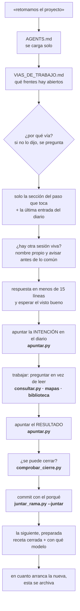
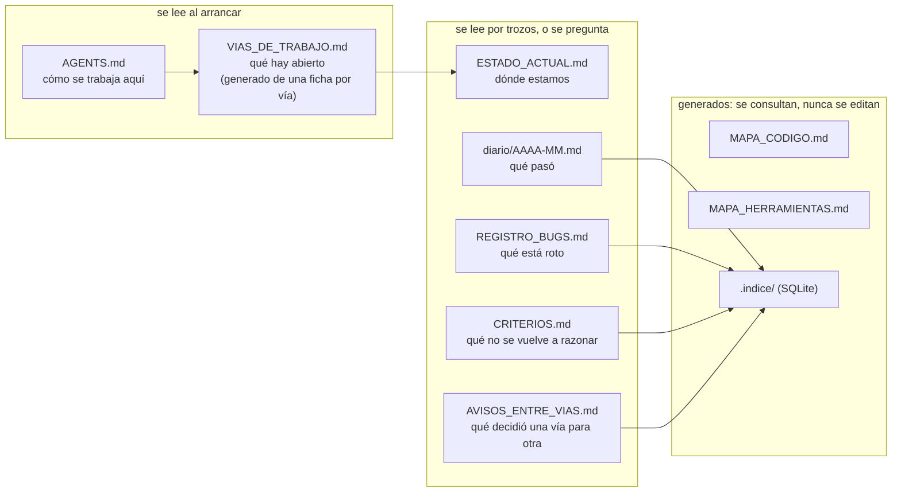

# Protocolo de agente

**Un método para llevar un proyecto largo con un agente de IA sin que se pierda entre sesiones.**

*[🇬🇧 Read it in English](README.md)*

No es una librería ni una herramienta. Son **seis documentos y doce programas** que resuelven un
problema concreto: cuando un proyecto dura meses, cada sesión con el agente empieza a ciegas. Se le
vuelve a explicar todo, se le paga el contexto entero, y aun así toma decisiones que contradicen las
de la semana pasada.

Este protocolo se escribió trabajando, no en abstracto. Nació de un proyecto real de un año, y cada
regla de aquí existe porque algo se rompió antes.

---

## El problema, en una frase

> Un agente no tiene memoria entre sesiones. Lo único que sabe es lo que lee al arrancar.
> **Así que lo que lee al arrancar es el diseño más importante del proyecto.**

De ahí salen las tres decisiones que gobiernan todo lo demás:

1. **El arranque es un presupuesto, no un saludo.** Cada línea que el agente lee al empezar se paga
   en **todas** las sesiones, para siempre. Un documento de 400 líneas que se abre "por si acaso"
   cuesta más que el trabajo que iba a hacer.
2. **Cada documento tiene una función y solo una.** Qué hay abierto, dónde estamos, qué pasó, qué
   está roto, qué se aprendió. En cuanto dos documentos cuentan lo mismo, uno de los dos miente —
   y no sabes cuál.
3. **Los mapas se generan, no se escriben.** Un índice mantenido a mano apunta a líneas equivocadas
   en cuanto alguien mueve una función. Un índice que miente es peor que no tener índice.

---

## El esquema

Una sesión, de principio a fin. Lo que está en **negrita** lo hace un programa; lo demás, el agente.



Y qué contesta cada documento, para que nunca dos contesten lo mismo:



---

## Qué hay aquí

### Los documentos

| Fichero | Qué resuelve |
|:---|:---|
| **[`AGENTS.md`](AGENTS.md)** | La plantilla del mapa de arranque. **Es la pieza central**: lo que el agente lee al abrir cada sesión |
| **[`CLAUDE.md`](CLAUDE.md)** | Un puntero de una línea a `AGENTS.md`, porque Claude Code no lee `AGENTS.md` de forma nativa |
| **[`PROTOCOLO_SESION.md`](PROTOCOLO_SESION.md)** | Cómo se abre, se lleva y se cierra una sesión. Qué modelo para qué paso. Varias sesiones a la vez. Cómo se deja preparada la siguiente |
| **[`LOS_DOCUMENTOS.md`](LOS_DOCUMENTOS.md)** | Qué función fija tiene cada documento, su techo y qué NO va en él |
| **[`LA_BIBLIOTECA.md`](LA_BIBLIOTECA.md)** | Cómo se ordenan las herramientas para no escribirlas dos veces ni correrlas a ciegas: la ficha, los estantes, el código compartido y el código que corre en otra máquina |
| **[`CRITERIOS.md`](CRITERIOS.md)** | Las lecciones que sobreviven al proyecto. Sobre todo: cómo se mide algo sin engañarse |
| **[`plantillas/`](plantillas/)** | Los documentos vacíos, listos para copiar |

### Los programas ([`herramientas/`](herramientas/))

Todos en Python, **sin dependencias** fuera de la biblioteca estándar. Ninguno lleva rutas dentro:
todo sale de `protocolo.config.json`. Cada uno lleva su **ficha** (`Contesta:` / `Toca:` /
`Necesita:`) en la cabecera.

| Programa | Qué contesta | ¿Toca algo? |
|:---|:---|:---|
| `comprobar_cierre.py` | ¿Se puede cerrar la sesión? | Solo lee |
| `medir_cuota_sesion.py` | ¿Cuánto pesó el arranque y dónde se fue la cuota? | Solo lee |
| `consultar.py` | ¿Qué trozos de los documentos hablan de X, y qué avisos tiene mi vía? | Solo lee (pone el índice al día) |
| `indice.py` | Pone al día el índice SQLite de diario, bugs, criterios y memoria | Escribe `.indice/` |
| `apuntar.py` | Deja la intención, el resultado o un aviso, con su formato y su letra del día | Escribe en el diario, bajo cerrojo |
| `generar_vias.py` | Arma la hoja de vías a partir de una ficha por vía | Escribe la hoja |
| `generar_mapa_codigo.py` | ¿En qué líneas vive cada función? | Escribe el mapa |
| `generar_mapa_herramientas.py` | ¿Qué herramienta contesta mi pregunta, y solo mira o cambia algo? | Escribe el mapa |
| `generar_mapa_servidor.py` | Lo mismo, para el código que corre en otra máquina | Escribe el mapa; allí no toca nada |
| `juntar_rama.py` | ¿Se puede llevar esta rama a la principal sin perder nada? Con `--juntar`, la lleva | Sin opciones, solo lee |
| `probar_juntar_rama.py` | ¿Varias sesiones pueden apuntar y juntar a la vez sin perder nada? (siete casos) | Solo en una carpeta temporal |
| `probar_cierre_mapas.py` | ¿Se vigila cada mapa contra *su* código, sin que le engañen las fechas en disco? (cinco casos) | Solo en una carpeta temporal |

`config.py`, `diario.py`, `terreno.py` y `comun/` son las piezas que los demás comparten.

---

## Empezar

```bash
git clone https://github.com/Saura13/protocolo-agente.git && cd protocolo-agente
```

1. Copia `AGENTS.md`, `CLAUDE.md` y la carpeta `plantillas/` a la raíz de tu proyecto.
2. Rellena los `<marcadores>` de `AGENTS.md`. Son pocos a propósito.
3. Copia `herramientas/` y crea tu `protocolo.config.json` a partir de
   `herramientas/protocolo.config.ejemplo.json`. Cada clave lleva al lado su explicación.
4. Copia `plantillas/gitattributes` como `.gitattributes`: así el diario y los avisos de dos sesiones
   se suman al juntar, en vez de chocar.
5. Genera los mapas:

```bash
python herramientas/generar_mapa_codigo.py
python herramientas/generar_mapa_herramientas.py
```

6. Cuando los documentos crezcan, deja de leerlos enteros: pregúntales.

```bash
python herramientas/consultar.py "qué toca a X"     # diez trozos con fichero:línea
python herramientas/consultar.py --toca BUG-040     # qué es, a qué enlaza y quién lo nombra
python herramientas/apuntar.py entrada --titulo "..." --texto intencion.md
```

7. Antes de cerrar, comprueba que se puede, y junta la rama:

```bash
python herramientas/comprobar_cierre.py
python herramientas/juntar_rama.py --juntar
```

8. Y mide lo que costó:

```bash
python herramientas/medir_cuota_sesion.py
```

Ese último número es el que ordena todo lo demás. **Antes de optimizar nada, mide qué fracción del
problema es.** En el proyecto de origen, el arranque costaba 61.101 tokens y la intuición decía que
sobraba documentación — pero al medirlo, **el 81% era configuración del entorno** y los documentos
propios eran el 19%. Podar documentos habría atacado un quinto del problema.

---

## Las piezas, en una línea cada una

| Pieza | La regla | Dónde se explica |
|:---|:---|:---|
| **El arranque** | Una orden fija que lee el desvío, pregunta la vía, lee solo el paso y espera | `PROTOCOLO_SESION.md` §1 |
| **Un asunto por sesión** | Lo roto que aparece de paso se anota sin diagnosticar, y se sigue | §2 |
| **Registrar al empezar** | La intención va al diario **antes** de trabajar | §3 |
| **Sin partes por el camino** | Releer cuesta con el cuadrado de los turnos: un informe al final | §4 |
| **El cierre, comprobado** | Lo que se puede comprobar lo comprueba un programa; lo demás lo recuerda | §5 |
| **El modelo por paso** | Cada paso lleva `[Opus]` o `[Sonnet]`; se elige al abrir y se avisa al cerrar | §8 |
| **Varias sesiones a la vez** | Nombre propio, avisar antes de tocar lo común, el diario se suma solo | §9 |
| **La siguiente, preparada** | Receta cerrada, con su comprobación y su regla de parada; la vieja se archiva | §10 |
| **Preguntar, no leer** | Un índice generado sobre todos los documentos, con enlaces entre ellos | `LOS_DOCUMENTOS.md` |
| **La biblioteca** | Preguntar antes de crear; cada herramienta con ficha; los nombres no se mueven | `LA_BIBLIOTECA.md` §2-3 |
| **El código que corre fuera** | Se cambia en casa y se despliega comparando huellas; allí no se parchea | `LA_BIBLIOTECA.md` §4 |
| **Una guía por operación** | Lo que se repite tiene su `GUIA_<OPERACIÓN>.md`, siempre con las mismas partes | `LA_BIBLIOTECA.md` §5 |

---

## Versiones

| Versión | Fecha | Qué trajo |
|:---|:---|:---|
| **0.1** | 23-24/08/2026 | El mapa de arranque, los documentos con función fija y techo, los mapas generados, el cierre comprobado, la medida de la cuota |
| **0.2** | 15-16/10/2026 | El índice y `consultar.py`; `apuntar.py`; la hoja de vías generada; los avisos entre vías; la ficha de cada herramienta; varias sesiones a la vez (`juntar_rama.py`) |
| **0.3** | 18/10/2026 | `LA_BIBLIOTECA.md` (las herramientas como biblioteca, el código que corre fuera, las guías por operación); el modelo por paso, comprobado en el cierre; las reglas de varias sesiones vivas; la siguiente sesión preparada; cada herramienta publicada con su ficha; **cada mapa declara su código** y el cierre lo vigila con fechas de git (`probar_cierre_mapas.py`); este esquema |

---

## Sobre qué agentes funciona

El contenido vive en **`AGENTS.md`**, el estándar abierto que desde diciembre de 2025 gobierna la
Agentic AI Foundation de la Linux Foundation y que leen más de treinta agentes: OpenAI Codex, GitHub
Copilot, Cursor, Gemini CLI, Google Antigravity, OpenCode, Zed, Windsurf, Aider, Jules, Devin.

**Claude Code es la excepción**: no lee `AGENTS.md` de forma nativa. Por eso este repositorio
incluye un `CLAUDE.md` que **no duplica el contenido**, solo lo importa con una línea.

> ⚠️ **No copies el mismo texto en varios ficheros.** Es la tentación obvia y se pudre sola: a las
> tres semanas no hay dos copias iguales y nadie sabe cuál manda. El contenido va en `AGENTS.md`;
> todo lo demás apunta a él.

Las etiquetas de modelo (`[Opus]` / `[Sonnet]`) son las del proyecto de origen. Si usas otros, cambia
las etiquetas en `protocolo.config.json`: la regla es la misma —un modelo que juzga y otro que ejecuta—.

---

## Licencia

MIT. Úsalo, córtalo y cámbialo.
