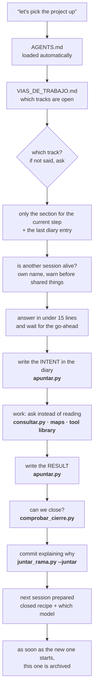
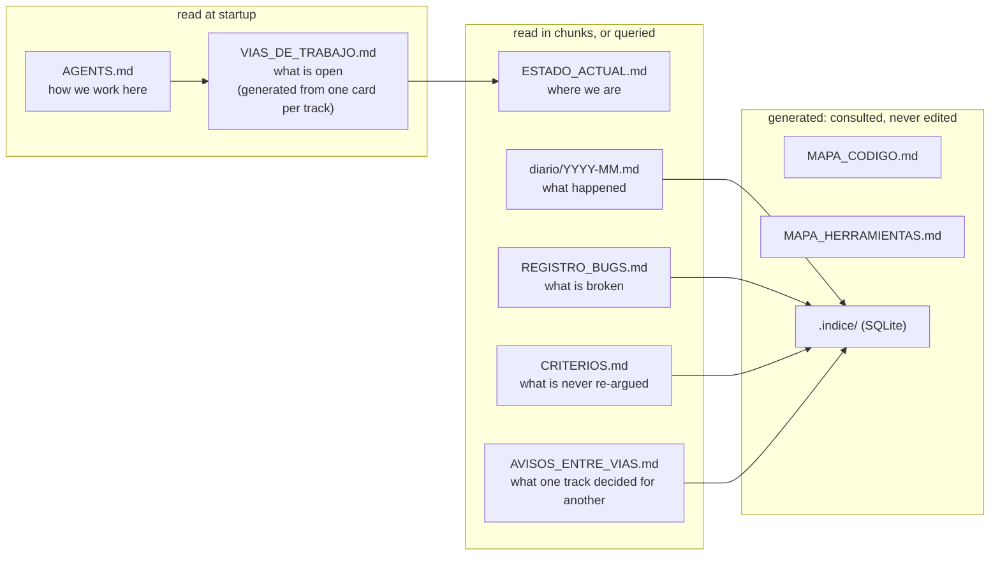

# Agent Protocol

**A method for running a long project with an AI agent without it losing the thread between
sessions.**

*[🇪🇸 Léelo en castellano](README.es.md) — the protocol documents themselves are in Spanish.
See [Language](#language) below.*

It is not a library and not a tool. It is **six documents and twelve programs** that solve one
concrete problem: when a project runs for months, every session starts blind. You explain
everything again, you pay for the whole context, and the agent still makes decisions that
contradict last week's.

This protocol was written while working, not in the abstract. It came out of a real year-long
project, and every rule here exists because something broke first.

---

## The problem, in one sentence

> An agent has no memory between sessions. All it knows is what it reads at startup.
> **So what it reads at startup is the most important design decision in the project.**

Three decisions follow from that, and they govern everything else:

1. **Startup is a budget, not a greeting.** Every line the agent reads at the start is paid for in
   **every** session, forever. A 400-line document opened "just in case" costs more than the work
   it was meant to enable.
2. **Each document has one job and only one.** What is open, where we are, what happened, what is
   broken, what we learned. The moment two documents say the same thing, one of them is lying —
   and you don't know which.
3. **Maps are generated, not written.** A hand-maintained index points at the wrong lines as soon
   as someone moves a function. An index that lies is worse than no index.

---

## The big picture

One session, start to finish. What is in **bold** is done by a program; the rest, by the agent.



And which question each document answers, so that no two ever answer the same one:



---

## What is here

### The documents

| File | What it solves |
|:---|:---|
| **[`AGENTS.md`](AGENTS.md)** | The startup-map template. **The central piece**: what the agent reads when it opens each session |
| **[`CLAUDE.md`](CLAUDE.md)** | A one-line pointer to `AGENTS.md`, because Claude Code does not read `AGENTS.md` natively |
| **[`PROTOCOLO_SESION.md`](PROTOCOLO_SESION.md)** | How a session is opened, run and closed. Which model for which step. Several sessions at once. How the next session is left ready |
| **[`LOS_DOCUMENTOS.md`](LOS_DOCUMENTOS.md)** | The fixed job of each document, its ceiling, and what does *not* go in it |
| **[`LA_BIBLIOTECA.md`](LA_BIBLIOTECA.md)** | How the tools are kept as a library so they are never written twice nor run blind: the tool card, the shelves, shared code, and code that runs on another machine |
| **[`CRITERIOS.md`](CRITERIOS.md)** | The lessons that outlive the project. Above all: how to measure something without fooling yourself |
| **[`plantillas/`](plantillas/)** | The empty documents, ready to copy |

### The programs ([`herramientas/`](herramientas/))

All Python, **no dependencies** outside the standard library. None carries a path inside: everything
comes from `protocolo.config.json`. Each one carries its **card** (`Contesta:` / `Toca:` /
`Necesita:` — answers / touches / needs) in its header.

| Program | What it answers | Does it change anything? |
|:---|:---|:---|
| `comprobar_cierre.py` | Can the session be closed? | Read-only |
| `medir_cuota_sesion.py` | How heavy was startup, and where did the quota go? | Read-only |
| `consultar.py` | Which chunks of the documents talk about X, and what notices does my track have? | Read-only (refreshes the index) |
| `indice.py` | Refreshes the SQLite index of diary, bugs, criteria and memory | Writes `.indice/` |
| `apuntar.py` | Writes the intent, the result or a notice, with its format and the day's letter | Writes the diary, under a lock |
| `generar_vias.py` | Builds the tracks sheet from one card per track | Writes the sheet |
| `generar_mapa_codigo.py` | On which lines does each function live? | Writes the map |
| `generar_mapa_herramientas.py` | Which tool answers my question, and does it only look or change something? | Writes the map |
| `generar_mapa_servidor.py` | The same, for code that runs on another machine | Writes the map; touches nothing there |
| `juntar_rama.py` | Can this branch go into the main one without losing anything? With `--juntar`, it does it | Read-only without options |
| `probar_juntar_rama.py` | Can several sessions write and merge at once without losing anything? (seven cases) | Only in a temporary folder |
| `probar_cierre_mapas.py` | Is each map checked against *its own* code, without being fooled by file dates? (five cases) | Only in a temporary folder |

`config.py`, `diario.py`, `terreno.py` and `comun/` are the pieces the others share.

---

## Getting started

```bash
git clone https://github.com/Saura13/protocolo-agente.git && cd protocolo-agente
```

1. Copy `AGENTS.md`, `CLAUDE.md` and the `plantillas/` folder into the root of your project.
2. Fill in the `<placeholders>` in `AGENTS.md`. There are deliberately few.
3. Copy `herramientas/` and create your `protocolo.config.json` from
   `herramientas/protocolo.config.ejemplo.json`. Every key has its explanation next to it.
4. Copy `plantillas/gitattributes` as `.gitattributes`: that way the diary and the notices of two
   sessions are added together on merge instead of clashing.
5. Generate the maps:

```bash
python herramientas/generar_mapa_codigo.py
python herramientas/generar_mapa_herramientas.py
```

6. Once the documents grow, stop reading them whole: ask them.

```bash
python herramientas/consultar.py "what touches X"   # ten chunks with file:line
python herramientas/consultar.py --toca BUG-040     # what it is, what it links to, who mentions it
python herramientas/apuntar.py entrada --titulo "..." --texto intent.md
```

7. Before closing, check that you can, and merge the branch:

```bash
python herramientas/comprobar_cierre.py
python herramientas/juntar_rama.py --juntar
```

8. And measure what it cost:

```bash
python herramientas/medir_cuota_sesion.py
```

That last number is the one that orders everything else. **Before optimising anything, measure what
fraction of the problem it is.** In the project this came from, startup cost 61,101 tokens and
intuition said there was too much documentation — but once measured, **81% was environment
configuration** and the project's own documents were 19%. Pruning documents would have attacked one
fifth of the problem.

---

## The pieces, one line each

| Piece | The rule | Where it is explained |
|:---|:---|:---|
| **Startup** | One fixed command that reads the router, asks for the track, reads only the step and waits | `PROTOCOLO_SESION.md` §1 |
| **One issue per session** | Anything broken found on the way is logged, undiagnosed, and work goes on | §2 |
| **Log before working** | The intent goes into the diary **before** starting | §3 |
| **No progress reports** | Re-reading costs grow with the square of the turns: one report at the end | §4 |
| **Checked closing** | What a program can check, it checks; the rest, it reminds you of | §5 |
| **A model per step** | Every step is tagged `[Opus]` or `[Sonnet]`; chosen when opening, announced when closing | §8 |
| **Several sessions at once** | Own names, warn before touching shared things, the diary merges by itself | §9 |
| **The next session, ready** | A closed recipe with its checks and its stop rule; the old session is archived | §10 |
| **Ask, don't read** | A generated index over every document, with links between them | `LOS_DOCUMENTOS.md` |
| **The tool library** | Ask before writing; every tool has a card; names never move | `LA_BIBLIOTECA.md` §2-3 |
| **Code that runs elsewhere** | Changed at home and deployed by comparing fingerprints; never patched in place | `LA_BIBLIOTECA.md` §4 |
| **One guide per operation** | Anything repeated gets its `GUIA_<OPERATION>.md`, always with the same parts | `LA_BIBLIOTECA.md` §5 |

---

## Versions

| Version | Date | What it brought |
|:---|:---|:---|
| **0.1** | 2026-08-23/24 | The startup map, documents with a fixed job and a ceiling, generated maps, checked closing, quota measurement |
| **0.2** | 2026-10-15/16 | The index and `consultar.py`; `apuntar.py`; the generated tracks sheet; notices between tracks; the tool card; several sessions at once (`juntar_rama.py`) |
| **0.3** | 2026-10-18 | `LA_BIBLIOTECA.md` (tools as a library, code that runs elsewhere, one guide per operation); a model per step, checked on closing; rules for several live sessions; the next session left ready; every published tool with its card; **each map declares its own code** and closing checks it with git dates (`probar_cierre_mapas.py`); these diagrams |

---

## Which agents this works with

The content lives in **`AGENTS.md`**, the open standard that since December 2025 is governed by the
Linux Foundation's Agentic AI Foundation and is read by more than thirty agents: OpenAI Codex,
GitHub Copilot, Cursor, Gemini CLI, Google Antigravity, OpenCode, Zed, Windsurf, Aider, Jules,
Devin.

**Claude Code is the exception**: it does not read `AGENTS.md` natively. That is why this repository
ships a `CLAUDE.md` that **does not duplicate the content** — it imports it in one line.

> ⚠️ **Do not copy the same text into several files.** It is the obvious temptation and it rots on
> its own: three weeks later no two copies match and nobody knows which one is authoritative. The
> content lives in `AGENTS.md`; everything else points at it.

The model tags (`[Opus]` / `[Sonnet]`) are the ones from the original project. If you use other
models, change the tags in `protocolo.config.json`: the rule is the same — one model that judges and
one that executes.

---

## Language

The protocol documents are **written in Spanish**, and this README is the English entry point.
That is a deliberate choice rather than an oversight:

- The documents you are reading here are read **once, by a person**. They cost the agent nothing.
- The files that are actually loaded into every session — `AGENTS.md` and `plantillas/` — are where
  language costs tokens, and they are the ones worth translating first.
- Translating everything would mean two full copies of the same rules, which is precisely the
  failure this repository warns against in the box above.

**If you want an English `AGENTS.md` and templates, open an issue.** That is the translation that
pays for itself, and it will be done properly — with one version declared authoritative — rather
than by duplicating the lot.

---

## Licence

MIT. Use it, cut it up, change it.
